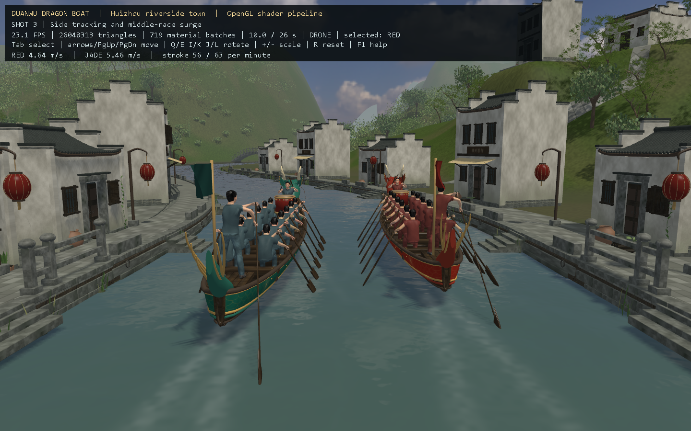

# 端午竞渡——龙舟争先

以端午龙舟竞渡为主题的计算机图形技术课程项目。使用 C++17、Win32/WGL 和 OpenGL Shader 构建皖南古镇河道场景，包含两艘龙舟、人物划桨与敲鼓、动态水纹，以及 26 秒独立无人机跟拍动画。



## 功能

- OBJ/MTL 加载、多材质纹理、模型平移/旋转/缩放与鼠标相机控制。
- Phong 光照、法线贴图、天空环境映射、方向光投影和四倍 MSAA。
- 两队独立变速与领先交替，24 支同步船桨、IK 烘焙人物动作、坐姿鼓手交替击鼓、船尾舵手与长桨联动，以及旗帜摆动。
- 独立于龙舟轨迹的五阶段镜头，包含低空跟拍、河湾转向和航拍收尾。
- 85 栋皖南风格民居、院落、田块、石岸、山脊地形，以及重新贴地的树木、灌木和竹丛。

## 下载与运行

模型和 Blender 文件由 **Git LFS** 管理。请安装 Git LFS 后完整克隆；仅下载 GitHub 的源码 ZIP 可能无法获得实际大文件。

```powershell
git lfs install
git clone https://github.com/messere1/duanwu-dragon-boat.git
cd duanwu-dragon-boat
git lfs pull
.\build.bat
.\run.bat
```

运行环境为 Windows。推荐 Visual Studio 2022，安装“使用 C++ 的桌面开发”和 Windows SDK，然后打开 `DragonBoat.sln`，选择 x64 编译。`build.bat` 也支持已加入 PATH 的 MinGW-w64。显卡驱动需支持着色器、帧缓冲、深度纹理和 MSAA；当前实测环境为 OpenGL 4.6 / RTX 3050。

第一次运行会从完整 OBJ 建立本地缓存；缓存和编译产物不进入仓库。程序的模型及贴图路径以工程目录为基准，建议保留原目录结构。

## 操作

| 操作 | 按键或鼠标 |
|---|---|
| 开始 / 暂停动画 | 空格 |
| 切换视角 | 1–4，3 为独立跟拍 |
| 选择模型 | Tab |
| 平移 / 升降模型 | 方向键、Page Up / Page Down |
| 旋转模型 | Q/E、I/K、J/L |
| 缩放 / 重置模型 | +/-、R |
| 改变观察方向 / 平移相机 | 鼠标左键拖动 / 右键拖动 |
| 自由相机移动 | WASD，Shift 加速 |
| 光照 / 纹理 / 法线 / 环境映射 | H / T / N / V |
| 阴影 / 线框 / 截图 | B / F / F12 |

完整操作说明见 [OpenGL运行与操作说明](docs/OpenGL运行与操作说明.md)。

## 模型与目录

- `dragonboat_realism.blend`：**最新完整可编辑场景**，包含山体几何、建筑细节与植被调整。
- `models/scene_preview.obj`：最新完整运行场景；其他 OBJ 为独立部件、补充组件或历史建模资产。
- `models/rowing_cycle.bin`、`drumming_cycle.bin`、`steering_cycle.bin`：人物动作数据。
- `models/helmsman_steering.blend`：新增的可编辑舵手掌舵动画；完整环境中的人物装配为静态参考。
- `src/`、`shaders/`：渲染器和着色器。
- `textures/`、`external_assets/`：纹理、开放素材与其来源记录。
- `tools/`：建模、导出、几何检查和验证脚本。部分阶段脚本依赖本机保存的工作基线，最终模型可直接编辑。
- `results/`：实际运行截图、验证结果及完整播放记录。
- `previews/`：各建模阶段的离线预览，部分图片反映历史版本。

`dragonboat_models.blend` 与 `models/dragonboat_scene.glb` 是保留的早期版本。当前结果以 `dragonboat_realism.blend` 和程序实际画面为准。

## 验证

```powershell
.\test.bat
.\bin\DragonBoat.exe --verify
.\bin\DragonBoat.exe --playthrough
```

本次发布前的记录通过 36 帧功能画面和完整 26 秒播放检查，OpenGL 错误为 0；85 栋房屋的 425 个地面支撑采样检查通过。结果见 [runtime_validation.json](results/runtime_validation.json) 和 [山体几何调整记录](docs/山体几何调整.md)。

水面、旗面、比赛速度和地形采用课程项目中的解析或程序化近似，没有进行完整流体、布料或地质侵蚀仿真。

舵手已使用随桨柄定向的双手握持，横柄和桨杆分别按手掌尺寸调整；包含 160 个插值姿态的掌部表面检查。模型近景见 `results/steering_grip_closeup.png`。修正及几何检查见 [船尾掌舵动作修正](docs/船尾掌舵动作修正.md)。

## 素材署名与许可

龙头改编自 **CalWhite 的 Chinese Dragon Head**，原作使用 **CC BY 4.0**。人物核心资产来自 **MakeHuman Community（CC0）**；部分树木、岩石、木板、石材和环境图来自 **Poly Haven（CC0）**。

作者、原始链接、许可及修改说明见 [开源参考与素材来源](docs/开源参考与素材来源.md)，下载文件记录见 [external_assets/manifest.json](external_assets/manifest.json)。第三方资产继续遵守各自许可；本仓库未为原创代码及其他原创文件另行指定开源许可证。

历史建模过程见 [建模阶段历史说明](docs/建模阶段历史说明.md)。
